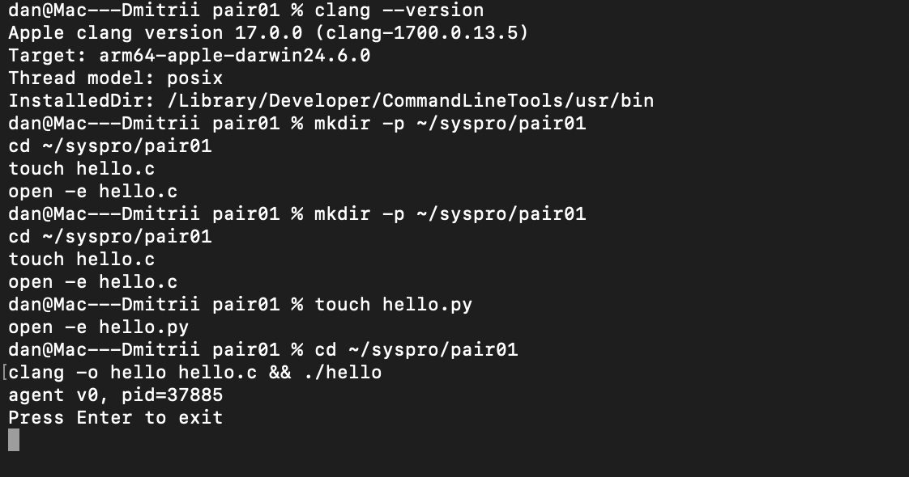
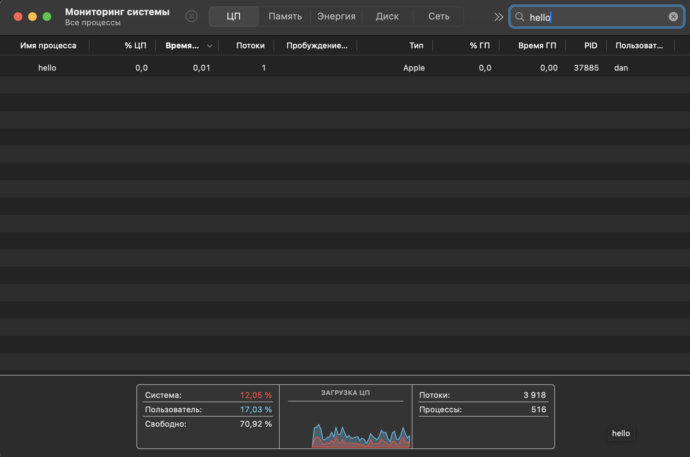
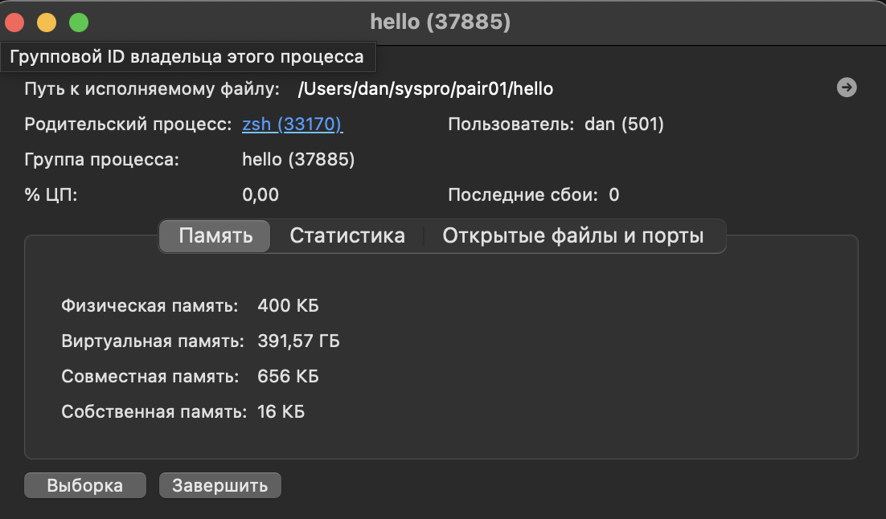
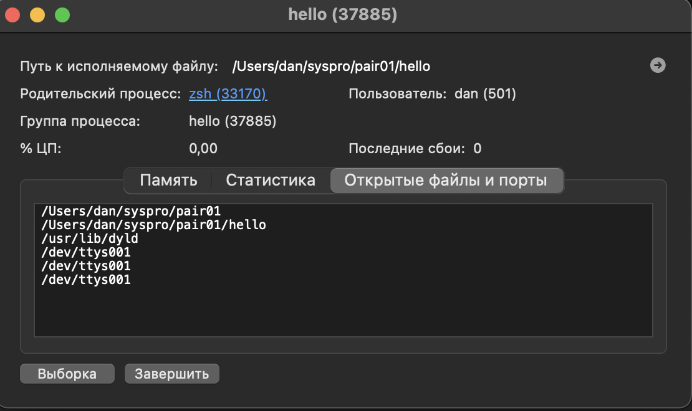
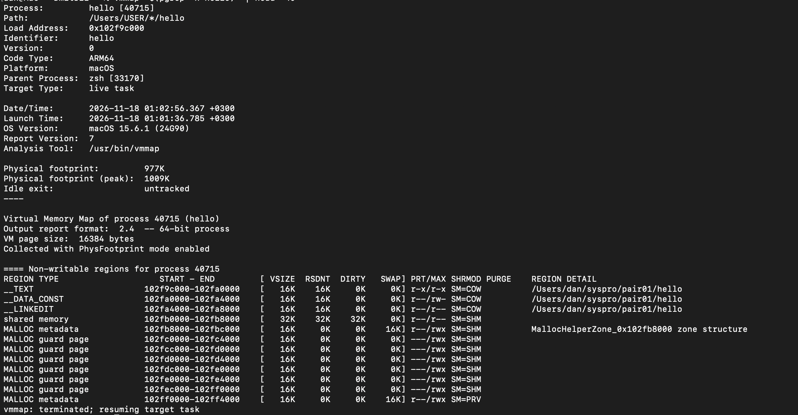
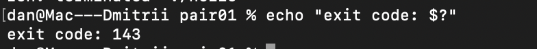
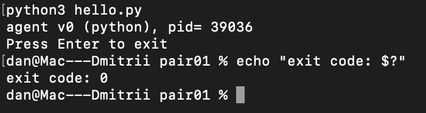

# ЛР 1. Процесс изнутри

Система: macOS 15.6.1 (arm64) · компилятор: Apple clang version 17.0.0 (clang-1700.0.13.5)

## Программа на C
Программа напечатала PID 37885, монитор показал PID 37885.
Память процесса в мониторе: физическая 400 КБ (собственная 16 КБ). Процессорное время: 0,01 с.
Пока программа ждёт Enter, процессорное время не растёт, потому что процесс ожидает ввод и не выполняется на процессоре.
Дескрипторов у процесса: 6. Ввод и вывод ведут в терминал (/dev/ttys001).
Загруженные системные компоненты: /usr/lib/dyld и libSystem (часть libSystem показана в карте vmmap как shared memory).
После завершения из монитора терминал напечатал «zsh: terminated», код завершения 143.

## Программа на Python
Имя процесса в мониторе: Python, PID 40498, физическая память 5,6 МБ.
Памяти больше, чем у программы на C, примерно в 14 раз (5,6 МБ / 0,4 МБ).
Общая библиотека у программ на C и Python: libSystem.
Код завершения при обычном выходе: 0.

Не получилось: список библиотек в vmmap был снят для hello (PID 40715), а не для первоначального процесса 37885; снимок показывает карту памяти и физический footprint 977 КБ, но библиотечные строки в кадр не попали.

## Снимки экрана

