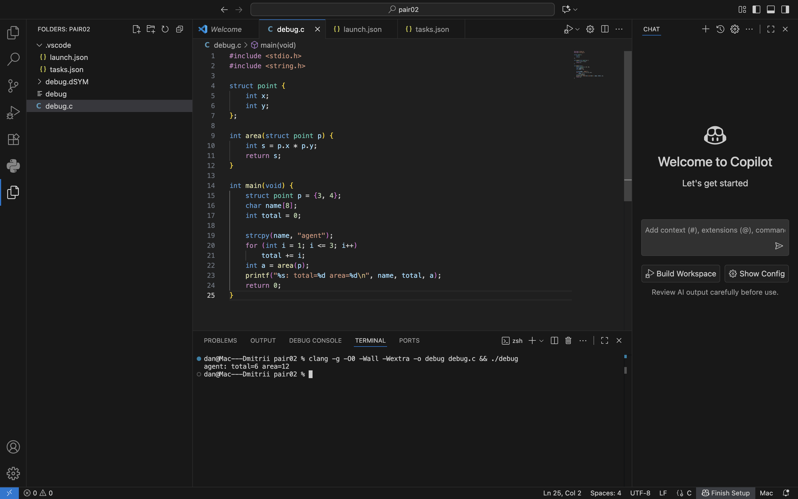
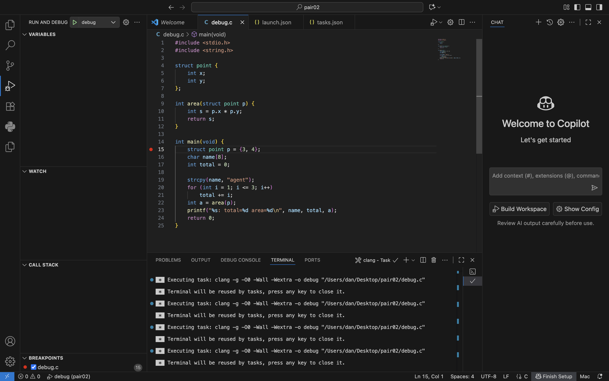
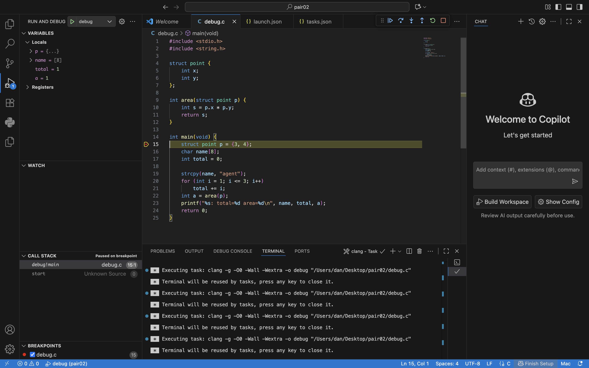
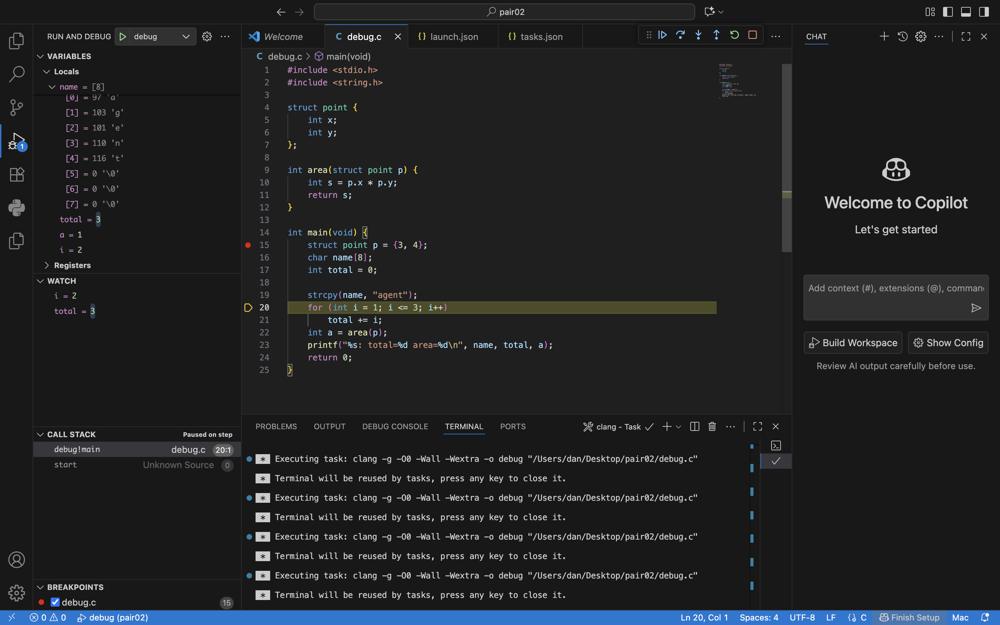
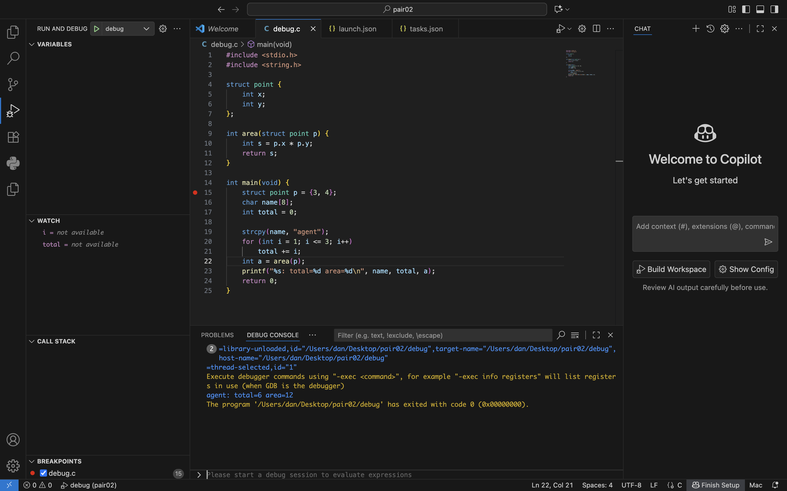
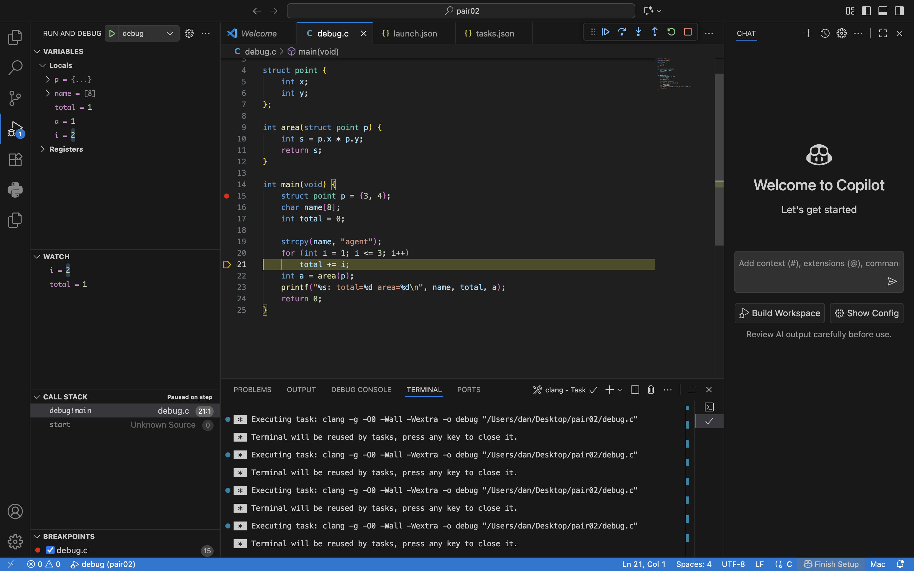
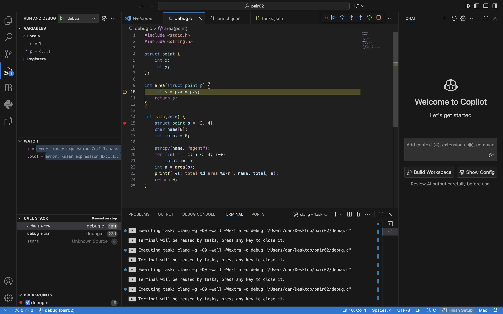
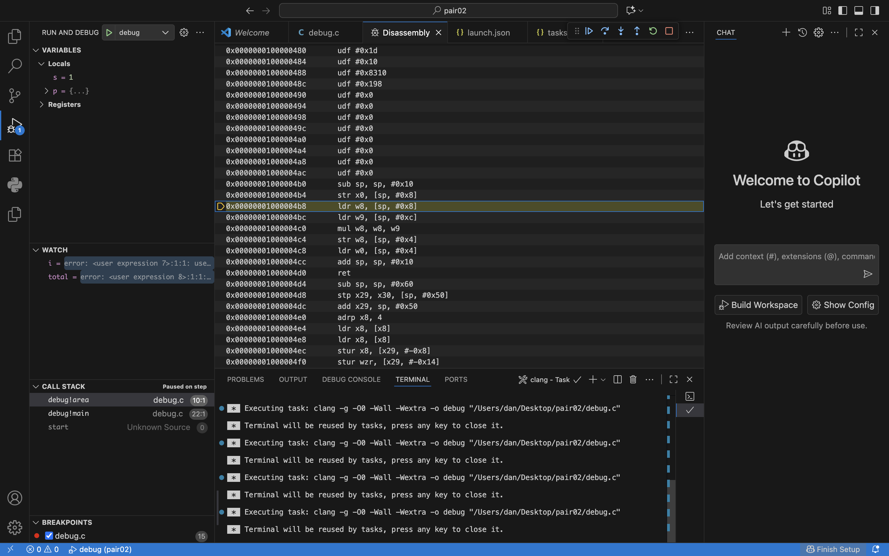

# ЛР 2. Программа в отладчике

Система: macOS (ARM64) · отладчик: LLDB

## Остановка и переменные
Программа без отладчика напечатала: `agent: total=6 area=12`
Точка останова на строке 15.
До строки 15: `p.x`, `p.y` и `total` ещё не инициализированы (их значения неопределённы).
После строки 15: `p.x = 3`, `p.y = 4`.
Строку 16 отладчик пропустил, потому что объявление массива без инициализации не содержит отдельной исполняемой команды.
`name[0] = 'a'` (код ASCII 97, `0x61`), завершающий ноль в ячейке `name[5]`.

## Цикл и функция
На кадре цикла: `i = 2`, `total = 1`; после следующего шага `total = 3`.
В стеке внутри `area` строк: 2, сверху функция `area`.
Команда умножения в машинном коде: `mul w8, w8, w9` (ARM64).
Перед `printf`: `a = 12`, `total = 6`.
Код завершения программы: 0.

Не получилось: отладчик на macOS показывает машинный код ARM64; значения неинициализированных переменных до выполнения присваиваний не имеют определённого значения.

## Снимки экрана

Сохраните снимок поверх заглушки в папке `screenshots/` с тем же именем — ссылки ниже менять не нужно.

### 1. Сборка и запуск без отладчика
Шаг 1. Видно: команда сборки и строка `agent: total=6 area=12`.

### 2. Точка останова
Шаг 3. Видно: красная точка у строки 15 и она же в списке Breakpoints.

### 3. Остановка перед строкой 15
Шаг 4. Видно: жёлтая стрелка у строки 15, переменные в Variables до присваивания.

### 4. Массив name по ячейкам
Шаг 6. Видно: раскрытый `name`: буквы `agent` и ноль в `[5]`.

### 5. Цикл в Watch
Шаг 7. Видно: `i` и `total` в разделе Watch на втором проходе цикла.

### 6. Внутри функции area
Шаг 8. Видно: стрелка в `area`, копия `p` в Variables, две строки в Call Stack.

### 7. Машинный код строки 10
Шаг 9. Видно: вкладка Disassembly с командой умножения.

### 8. Программа доработала
Шаг 11. Видно: вывод программы под отладчиком и код завершения.

