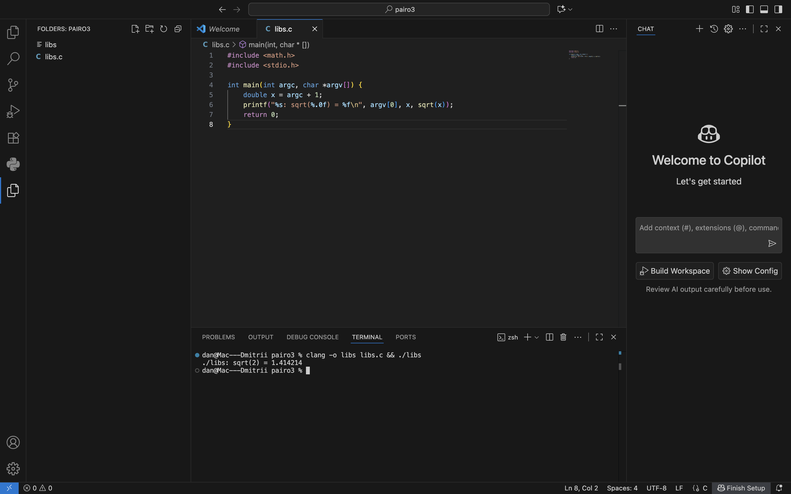
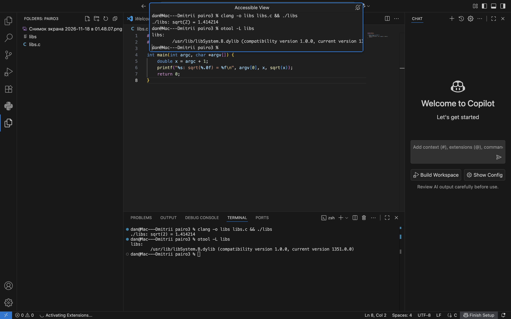
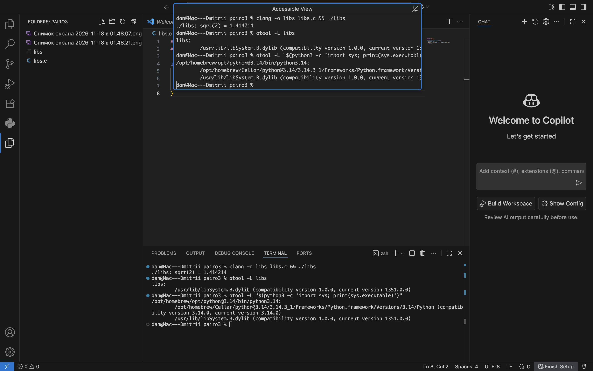
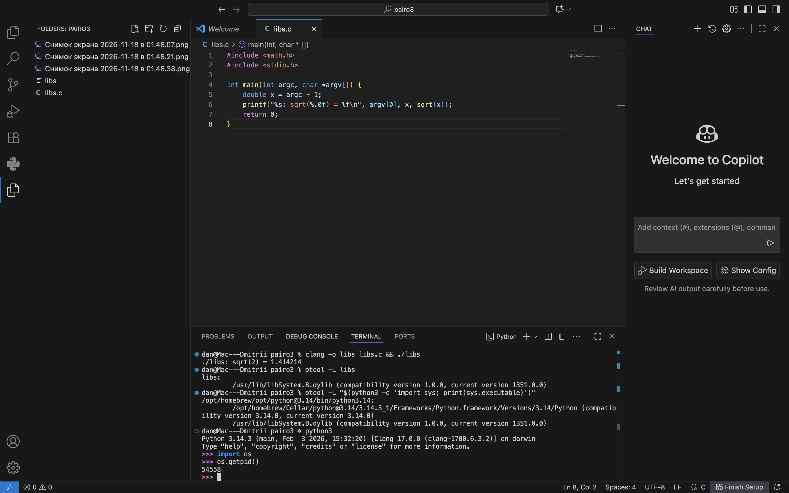
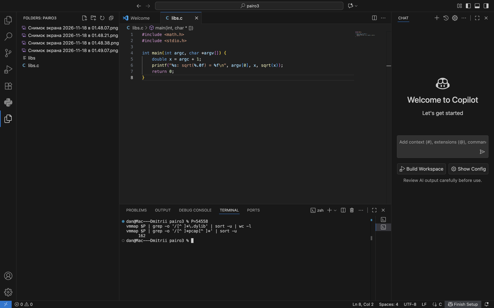
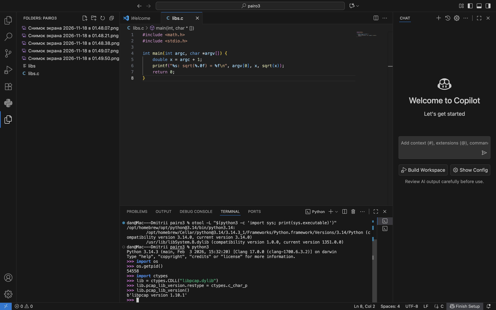
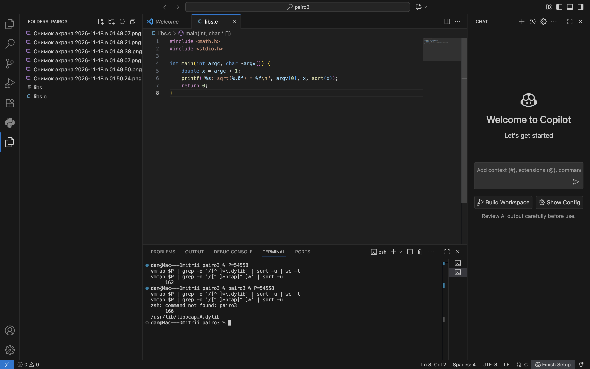

# ЛР 3. Библиотеки программы

Система: macOS (Apple Silicon, ARM64), Python 3.14.3

## Библиотеки файла
Программа напечатала: `./libs: sqrt(2) = 1.414214`
Команда для списка библиотек файла: `otool -L libs`
Библиотеки libs: `/usr/lib/libSystem.B.dylib`
Почему в списке нет отдельной математической библиотеки: в macOS функции C, математика и системные вызовы собраны в `libSystem.B.dylib`.
Где лежит интерпретатор Python (файл или библиотека): исполняемый файл `/opt/homebrew/opt/python@3.14/bin/python3.14`; библиотека интерпретатора `/opt/homebrew/Cellar/python@3.14/3.14.3_1/Frameworks/Python.framework/Versions/3.14/Python`.

## Библиотеки процесса
PID Python: 54558
Библиотек в процессе до ctypes.CDLL: 162, после: 166
Загруженная библиотека и её полный путь: `/usr/lib/libpcap.A.dylib`
Функция вернула: `b'libpcap version 1.10.1'`

Не получилось: в одном снимке терминал показал ошибку из-за случайно вставленного фрагмента приглашения командной строки; повторный запуск команд завершился успешно. Числа и путь записаны по успешному выводу.

## Снимки экрана

Снимки сохранены в `screenshots/` с именами из бланка:

