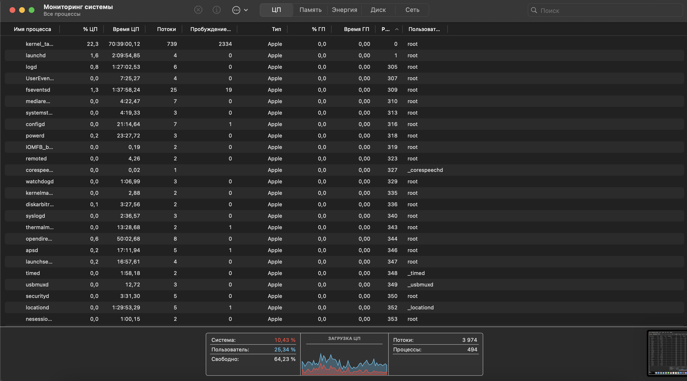
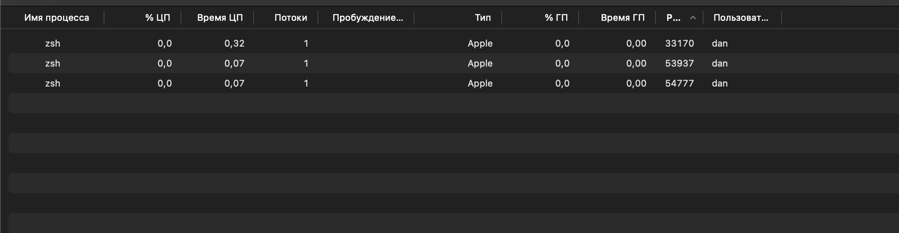
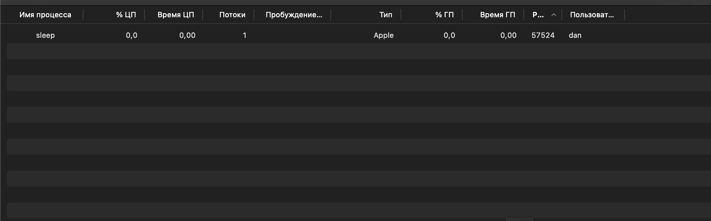
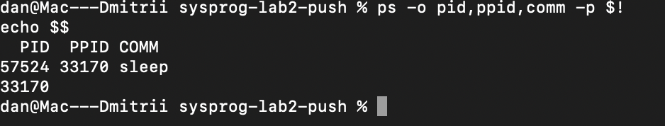
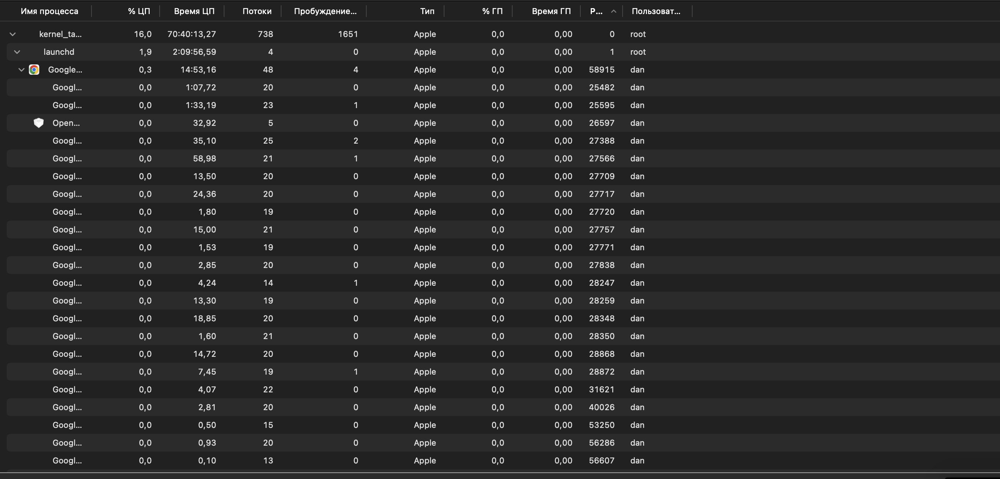
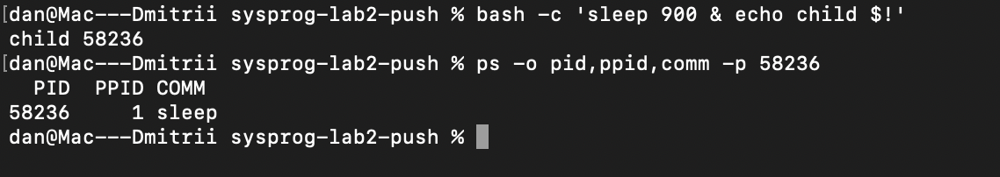
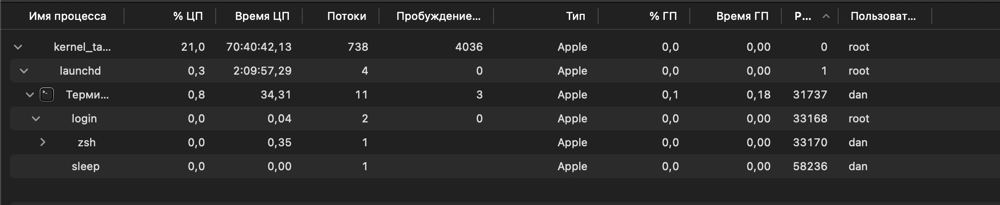

# ЛР 4. Дерево процессов

Система: macOS (Apple Silicon)

## Дерево
Процесс в начале дерева и его номер: `kernel_task`, PID 0; далее `launchd`, PID 1.
Цепочка родителей терминала (имя и номер): `zsh` (33170) → `login` (33168) → Терминал (31737) → `launchd` (1).
Дочерний процесс: `sleep`, номер 57524, родитель `zsh`, PID 33170.
Команда, которой проверен родитель: `ps -o pid,ppid,comm -p $!`; PID 57524, PPID 33170. `echo $$` вывела PID оболочки 33170 — родитель совпал с деревом.
Процессов у браузера и имя процесса вкладок: 22 дочерних процесса Google Chrome, включая процессы `Google Chrome Helper`, обслуживающие вкладки.

## Сирота
Номер сироты: `sleep`, PID 58236.
Номер родителя до и после завершения настоящего родителя: сначала родитель — временный `bash`; после его завершения PPID стал 1.
Где сирота стоит в дереве: под `launchd` (PID 1); система переназначила ему оставшийся процесс после завершения родительской оболочки.

## Снимки экрана

