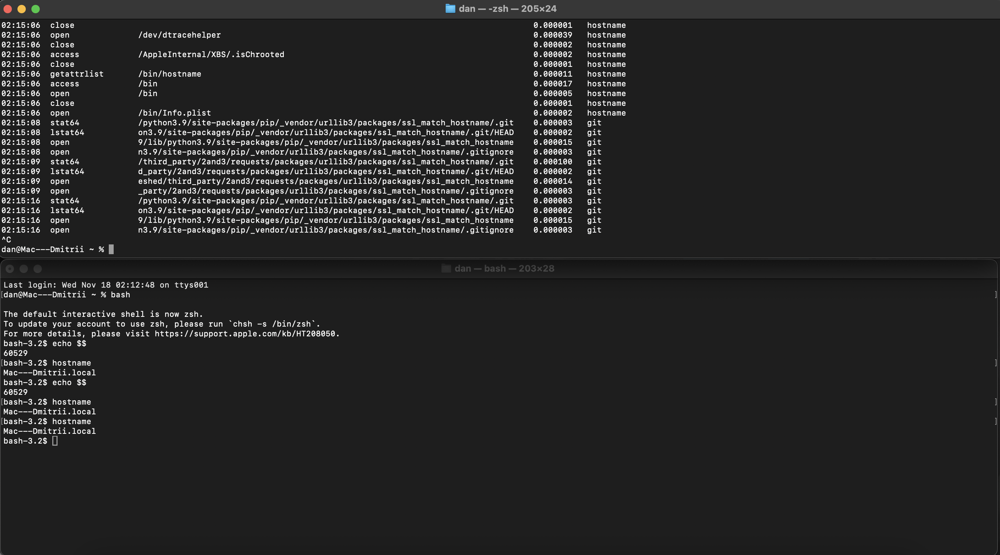
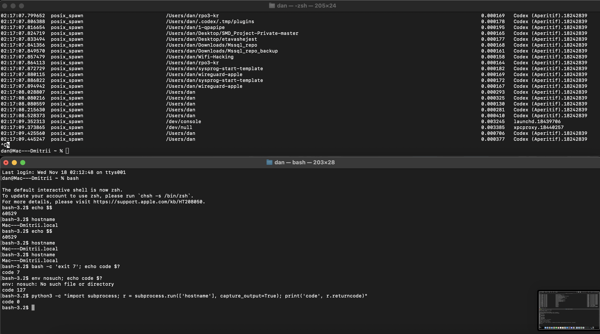

# ЛР 5. Рождение процесса

Система: macOS (Apple Silicon)
Программа записи: `sudo fs_usage`

## Рождение
Родитель: `bash`, PID 60529.
Новая программа: `hostname`.
Событие создания процесса: `posix_spawn`.

## Завершение
Код завершения у ребёнка и у родителя: 7.
Для `nosuch` система вывела `No such file or directory`; код завершения — 127.

## Запуск из Python
Python запустил `hostname` через `subprocess.run`, забрал вывод и получил код возврата 0.

## Снимки экрана

