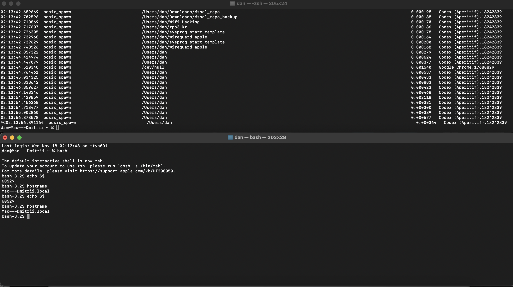
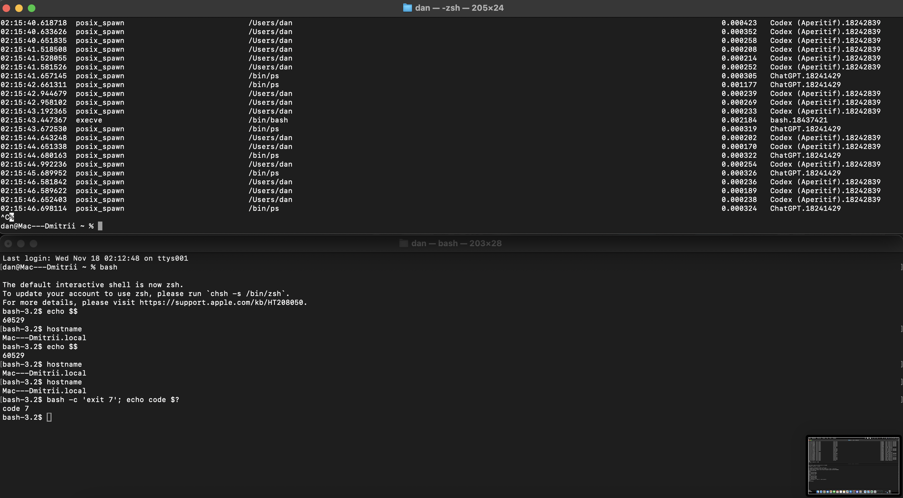
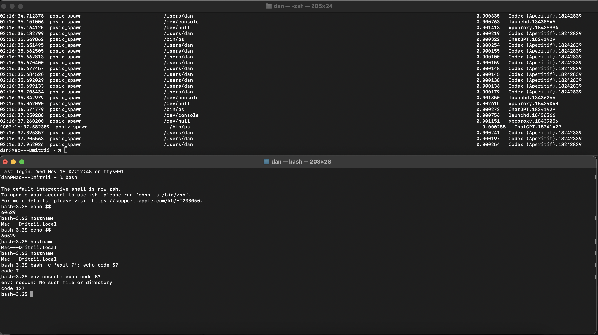

# ЛР 5. Рождение процесса

Система: macOS (Apple Silicon)
Программа записи: `sudo fs_usage`

## Рождение
Родитель (имя и номер): `bash`, PID 60529.
Номер нового процесса: `hostname` (PID в записи не указан).
Событие или вызов, которым создан процесс: `posix_spawn`.
Библиотек загружено и первая из них: снимок показывает обращения `hostname` к `/bin/hostname` и `/bin`; число и имена загруженных библиотек в записи не отображены.

## Завершение
Код завершения у ребёнка и у родителя: 7.
Программа nosuch: число папок поиска не отображено, ошибка `No such file or directory`, код 127.

## Запуск из Python
Номер Python и номер ребёнка: команда завершилась с кодом 0; PID процессов в записи не указан.
Чем запуск из Python отличается от запуска из оболочки: Python запускает `hostname` через `subprocess.run`, забирает вывод и читает код возврата через `r.returncode`.

Не получилось: в приложенных записях не отображены PID нового `hostname`, количество и первая библиотека, число проверенных папок и PID Python с дочерним процессом.

## Снимки экрана

