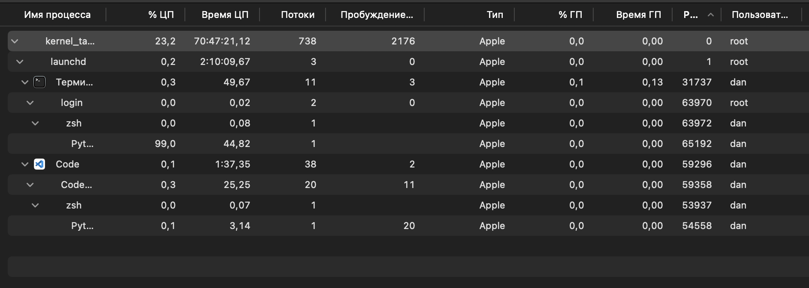
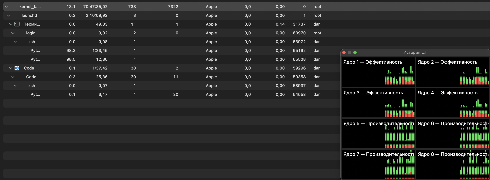
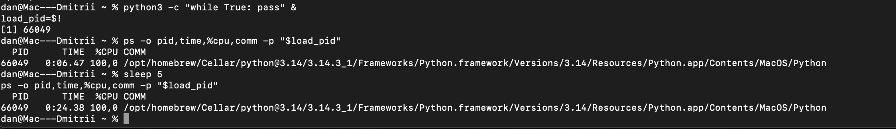
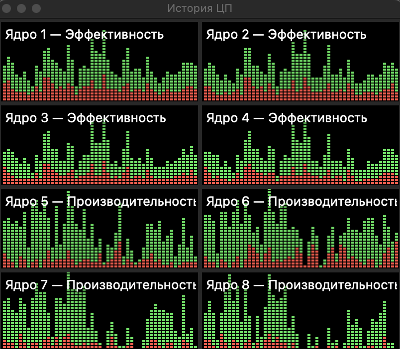

# ЛР 6. Кто загружает процессор

Система: macOS 15.6.1, Apple Silicon
Ядер (логических процессоров): 8

## Одна нагрузка
Процент процесса в мониторе: около 99%.
Общая загрузка: около 12,5% от общей мощности процессора — одна полностью занятая логическая линия из восьми.
На каких ядрах видна нагрузка: графики показывают активность на всех ядрах; macOS распределяет нагрузку между ними.

## Две нагрузки
Проценты обеих нагрузок и общая загрузка: около 98,3% и 98,5%; примерно 25% общей мощности восьми логических ядер.
На одном ядре (в macOS — фоновый режим): за 3 секунды обычный процесс выполнил 34 317 293 итерации, фоновый — 5 515 662. В фоновом режиме итераций примерно в 6 раз меньше.

## Процессорное время
Первый замер, второй замер, пауза: 0:06.47 и 0:24.38; между замерами выполнена пауза 5 секунд.
Загрузка по замерам: `ps` показал 100% в обоих замерах.
Почему процент в мониторе не говорит о скорости работы: процент показывает, какую долю процессорного времени получил процесс. Он не измеряет количество выполненной работы за секунду: это видно по разнице количества итераций в обычном и фоновом режимах.

## Снимки экрана

Сохраните снимок поверх заглушки в папке `screenshots/` с тем же именем — ссылки ниже менять не нужно.

### 1. Одна нагрузка
Шаг 1. Видно: процесс Python в мониторе: его процент и общая загрузка.

### 2. Две нагрузки
Шаг 3. Видно: два процесса Python и загрузка ядер.

### 3. Нагрузки на одном ядре
Шаг 4. Видно: две нагрузки на одном ядре и их проценты; в macOS — два числа оборотов цикла.

### 4. Процессорное время
Шаг 5. Видно: два замера процессорного времени с паузой между ними.

