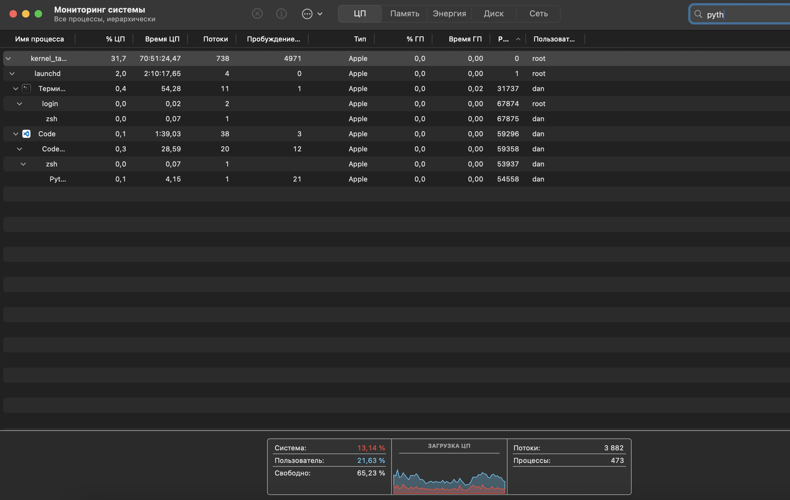
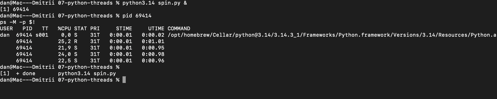
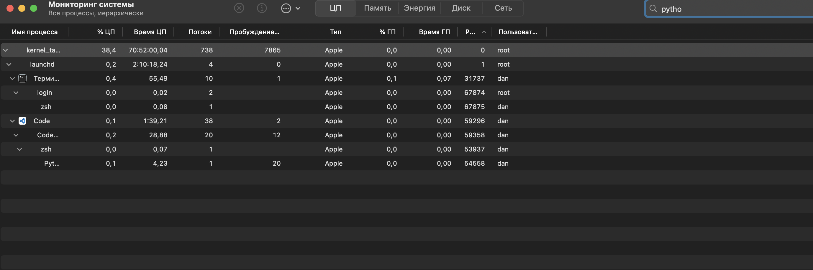
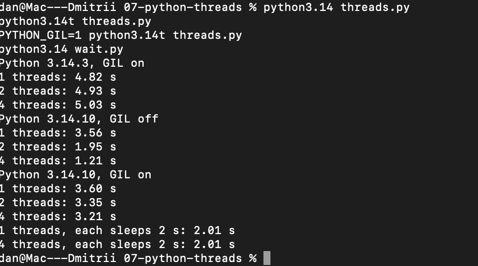

# ЛР 7. Потоки Python и GIL

Система: macOS 15.6.1, Apple Silicon
Ядер (логических процессоров): 8
Версии Python: 3.14.3 с GIL и 3.14.10 без GIL

## Python с GIL
В программе 5 потоков: главный и 4 рабочих. По `ps -M` загрузка рабочих составила 25,2%, 21,9%, 24,0% и 22,5% — вместе около 93,6%, то есть примерно одно ядро.
Одновременно выполнялся один рабочий поток (STAT `R`); остальные три ожидали (STAT `S`).

## Python без GIL
Четыре рабочих потока выполняют вычисления параллельно на доступных ядрах. Не успел сделать снимок загрузки: процессы слишком быстро завершались. В замере времени версия без GIL завершила работу на четырёх потоках за 1,21 с.

## Время работы
С GIL, 1 / 2 / 4 потока: 4,82 / 4,93 / 5,03 с.
Без GIL, 1 / 2 / 4 потока: 3,56 / 1,95 / 1,21 с.
Без GIL с PYTHON_GIL=1: 3,60 / 3,35 / 3,21 с.
Ожидание, 1 и 4 потока: 2,01 / 2,01 с.
Почему ожидающие потоки ускоряются и с GIL: поток во время ожидания сна освобождает GIL, поэтому остальные могут продолжать работу; четыре ожидания проходят одновременно, а не последовательно.

## Снимки экрана

Сохраните снимок поверх заглушки в папке `screenshots/` с тем же именем — ссылки ниже менять не нужно.

### 1. Четыре потока с GIL
Шаг 1. Видно: процесс Python в мониторе: его процент и число потоков.

### 2. Потоки процесса
Шаг 2. Видно: список потоков процесса: сколько выполняется, сколько ждёт.

### 3. Четыре потока без GIL
Шаг 3. Видно: процесс python3.14t в мониторе: его процент.

### 4. Время работы
Шаг 4. Видно: вывод threads.py в Python с GIL и без.

