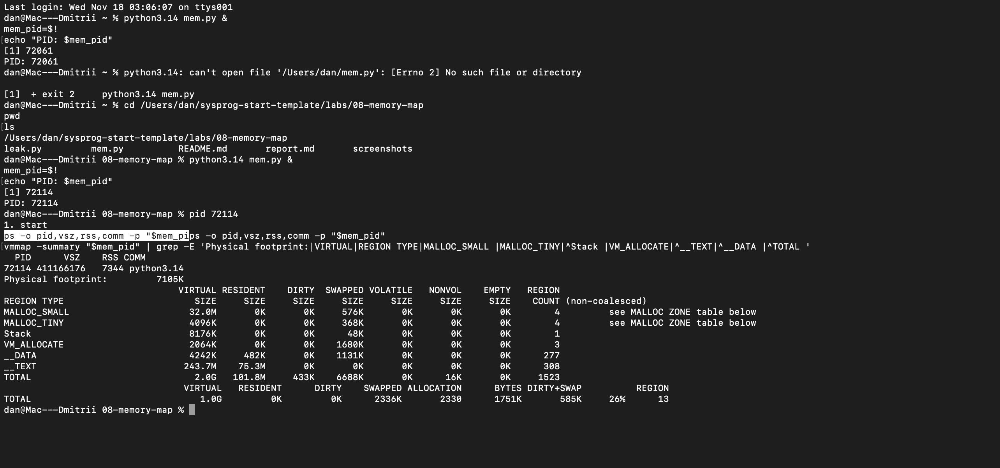
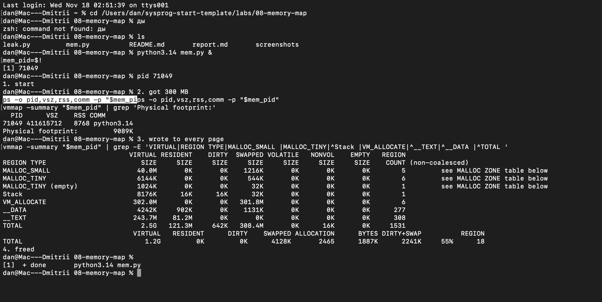
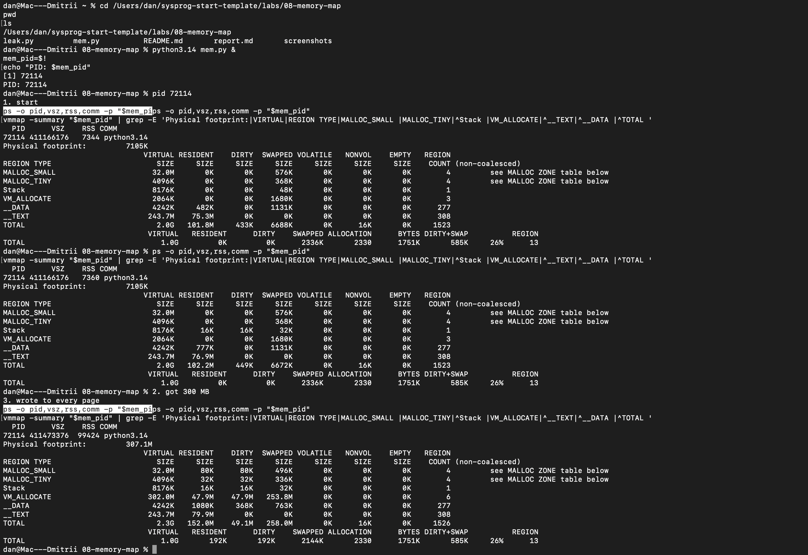
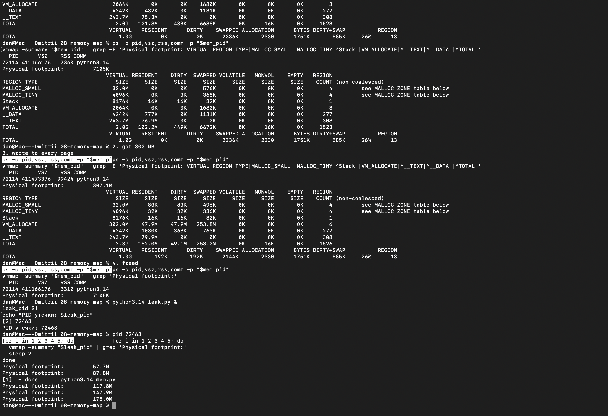

# ЛР 8. Карта памяти

Система: macOS 15.6.1, Apple Silicon
Чем мерил (виртуальная и занятая): `ps` (VSZ и RSS), `vmmap` (карта памяти и Physical footprint).

## Этапы mem.py
Старт: VSZ 411 166 176 КБ, RSS 7 344 КБ, физический след 7 105 КБ (около 7 МБ).
Получил 300 МБ: область VM_ALLOCATE около 302 МБ; физический след около 9 089 КБ (около 9 МБ), почти без изменений.
Записал в каждую страницу: физический след 307,1 МБ; RSS 99 424 КБ.
Освободил: RSS 3 312 КБ, физический след 7 105 КБ (около 7 МБ).
Почему занятая память выросла только на третьем этапе: резервирование выделило адресное пространство, но реальные страницы были задействованы при записи. После записи физический след вырос; macOS сжала большую часть нулевых страниц, поэтому RSS не показывает полный объём.

## Карта памяти
Из каких частей состоит память процесса: области кода Python и библиотек (`__TEXT`), данных (`__DATA`), кучи (`MALLOC_SMALL`, `MALLOC_TINY`), стека (`Stack`) и выделенных областей (`VM_ALLOCATE`). В итоговой карте виртуальный размер около 1,0 ГБ.

## Утечка
Пять замеров leak.py: 57,7 → 87,8 → 117,8 → 147,9 → 178,0 МБ.
На сколько росла память за 2 секунды: примерно на 30 МБ за каждый интервал. Память последовательно увеличивалась, не возвращаясь к исходному уровню.

## Снимки экрана

Сохраните снимок поверх заглушки в папке `screenshots/` с тем же именем — ссылки ниже менять не нужно.

### 1. Карта памяти
Шаг 2. Видно: карта памяти процесса mem.py на старте и её итог.

### 2. Получено 300 МБ
Шаг 3. Видно: виртуальная память выросла на 300 МБ, занятая — нет.

### 3. Страницы заняты
Шаг 4. Видно: занятая память (в macOS — физический след) после записи в каждую страницу.

### 4. Утечка
Шаг 6. Видно: пять замеров памяти leak.py.

