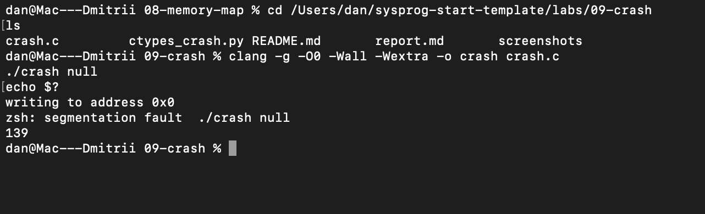
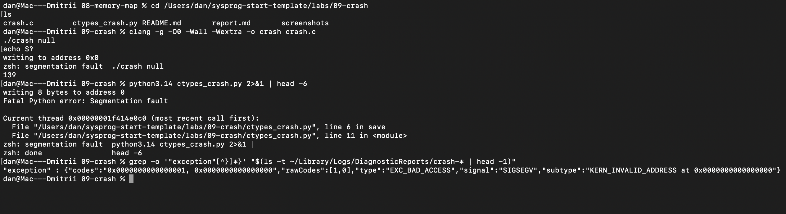
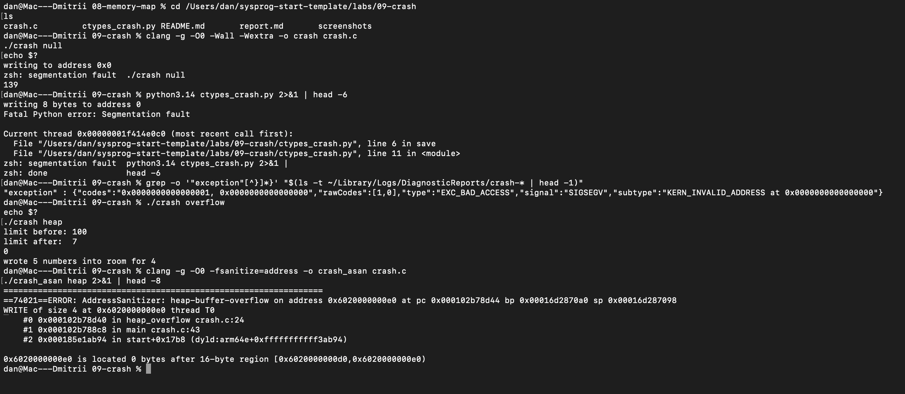
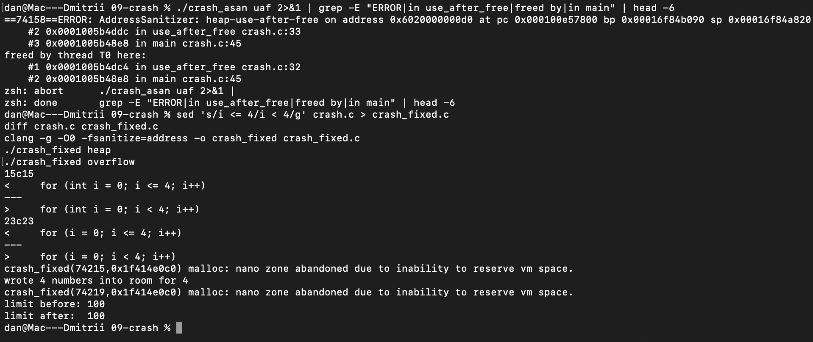

# ЛР 9. Разбор падения

Система: macOS 15.6.1, Apple Silicon
Компилятор: Apple clang из Command Line Tools

## Падение
crash null: напечатано `writing to address 0x0`, затем `zsh: segmentation fault`; код завершения 139.
ctypes_crash.py: Python напечатал `writing 8 bytes to address 0`, затем `Fatal Python error: Segmentation fault`; стек указывает на строку 6 в `save` и строку 11 в основном коде.
Где система записала падение: `~/Library/Logs/DiagnosticReports/crash-*.ips`. В отчёте указаны `EXC_BAD_ACCESS`, `SIGSEGV` и `KERN_INVALID_ADDRESS at 0x0000000000000000`.

## Молчаливые ошибки
crash overflow: `limit` изменился со 100 на 7, код завершения 0.
crash heap без проверки: напечатано `wrote 5 numbers into room for 4`; ошибка прошла без остановки.
AddressSanitizer для heap: `heap-buffer-overflow`, запись размером 4 байта за 16-байтовую область; строка `crash.c:24`.
AddressSanitizer для uaf: `heap-use-after-free`; чтение в строке 33, освобождение памяти в строке 32.

## Исправление
В обоих циклах заменено условие `i <= 4` на `i < 4` (строки 15 и 23). Исправленная программа напечатала `wrote 4 numbers into room for 4`; для `overflow` значение `limit` осталось 100. AddressSanitizer ошибок не сообщил.

## Снимки экрана

Сохраните снимок поверх заглушки в папке `screenshots/` с тем же именем — ссылки ниже менять не нужно.

### 1. Падение
Шаг 1. Видно: запуск crash null и код завершения.

### 2. Падение Python
Шаг 2. Видно: вывод ctypes_crash.py и запись системы о падении.

### 3. Отчёт AddressSanitizer
Шаг 4. Видно: вывод crash heap без проверки и с AddressSanitizer (на Windows с ARM — без проверки).

### 4. Исправление
Шаг 6. Видно: разница файлов и вывод исправленной программы.

